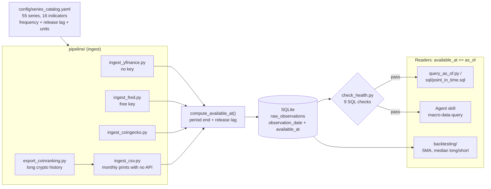

# macro-regime-data-pipeline

A point-in-time macro and market dataset (FRED, Yahoo Finance, CoinGecko, Coinranking,
staged CSVs into SQLite) with release-lag handling, SQL health checks, an agent skill
that queries it safely, and two small backtesters.

> Research tooling, not investment advice. Nothing here is a recommendation to buy or
> sell anything. Sample data in this repo is synthetic.

## The problem

Regime models (is the economy in reflation, stagflation, goldilocks or recession?)
mix series that update on very different schedules: daily prices, weekly Fed balance
sheet data, monthly CPI and PMI, crypto data that is only daily. Three things go wrong
when they are joined naively:

1. **Lookahead.** FRED labels September CPI `2025-09-01`, but it is published in
   mid-October. Joining on the label date lets a backtest "know" inflation six weeks
   early. Nothing errors; the results just look better than they could be live.
2. **Silent data problems.** A series stops updating, a provider drops a dataset (FRED
   removed the London gold fix in 2022), units differ between related series (the Fed's
   reverse repo is in billions, its balance sheet in millions). A backtest runs anyway.
3. **Agents guessing.** An AI assistant asked "what's the yield curve doing?" either
   answers from memory or makes live API calls with no notion of "as of" and no check
   on whether the data is sound.

## Approach

One catalog, one time rule, one health gate, and point-in-time reads for everyone.



- **Three clocks.** The data clock (when a value could be known), the signal clock (when
  scores are recomputed) and the execution clock (when trades fill) are kept separate.
  Every row stores `observation_date` and `available_at = period end + release lag`.
  Readers only see rows with `available_at <= as_of`, and the backtester fills on the
  bar after the signal. Full explanation with diagrams and a worked example:
  [docs/three-clocks.md](docs/three-clocks.md).
- **Catalog as the contract.** Provider, code, units, native frequency, release lag and
  `exact`/`proxy` coverage live in YAML and are seeded into the database, so the data
  explains itself. [docs/data-sources.md](docs/data-sources.md) covers the indicator map
  and source decisions.
- **Health checks in SQL.** [`sql/health_checks.sql`](sql/health_checks.sql): ISO dates,
  no value available before its period, catalog lag respected, monthly and quarterly lags
  counted from the end of the period (not the label date), observed frequency
  matches catalog, every active series has rows, nothing stale for its frequency, no
  non-positive prices, last ingestion run per provider succeeded. Each check returns the
  failing rows, so an empty result is a pass.
- **Agent-ready data product.** The skill in
  [`agent_skill/macro-data-query`](agent_skill/macro-data-query/SKILL.md) makes an agent
  run the health check first, query only point-in-time, and cite `observation_date`,
  `available_at` and proxy caveats in every answer. Rationale:
  [docs/agent-data-product.md](docs/agent-data-product.md).

## Results

Measured by running this repo (Python 3.9, macOS):

| What | Result |
|---|---|
| Unit tests (`python -m unittest discover -s tests`) | 15 pass, about 3 s, no network |
| Synthetic sample (`make_synthetic_sample.py`, 2 years) | 53 active series, 22,887 rows, 9 of 9 health checks pass |
| Keyless real-data run (5 yfinance series from 2024-01-01) | 3,881 rows in about 6 s, 9 of 9 checks pass |
| Lookahead guard | As of 2025-10-10 the point-in-time query returns August CPI (available 2025-09-14), not September CPI (available 2025-10-14). A naive label-date rule would have exposed September CPI from 2025-09-15. |
| Lag-violation detection | Storing CPI with no lag (`available_at` = label date) makes `lag_respected` fail. The subtler bug, label date + lag, passes `lag_respected` exactly; `lag_from_period_end` flags all 191 monthly rows of the sample built that way and none of the correct sample. Both cases are covered by tests, and `check_health.py` exits 1 |

Backtest numbers on the synthetic universe are random-walk output and say nothing about
any real strategy.

## Quickstart

Needs Python 3.9+. About five minutes.

```bash
git clone <this repo> && cd macro-regime-data-pipeline
python -m venv .venv && source .venv/bin/activate
pip install -r requirements.txt

# 1. Offline: build the SYNTHETIC sample, check it, query it
python pipeline/make_synthetic_sample.py --db-path data/sample.db
python pipeline/check_health.py --db-path data/sample.db
python pipeline/query_as_of.py --db-path data/sample.db --as-of 2025-10-10 --indicator I1 --history 3

# 2. Real public data, no key (yfinance)
python pipeline/run_pipeline.py --providers yfinance --start-date 2024-01-01 \
  --series YF:SPY,YF:GLD,YF:TLT,YF:BTC-USD,YF:^VIX
python pipeline/query_as_of.py --as-of 2025-06-30 --series YF:SPY,YF:GLD,YF:BTC-USD

# 3. Add FRED with a free key (https://fred.stlouisfed.org/docs/api/api_key.html)
export FRED_API_KEY=...
python pipeline/run_pipeline.py --providers yfinance,fred --start-date 2018-01-01

# 4. Load a staged monthly series (synthetic example values)
python pipeline/ingest_csv.py examples/manual_series_SYNTHETIC.csv

# 5. Tests and backtests
python -m unittest discover -s tests -v
python backtesting/src/sample/make_synthetic_bars.py
python backtesting/src/backtest/run_strategy.py --strategy median_long_short \
  --start-date 2024-01-01 --end-date 2025-12-31
```

Keys are read from environment variables; see [`.env.example`](.env.example). To use a
`.env` file: `set -a; source .env; set +a`.

## Repo layout

```
config/series_catalog.yaml     55 series, 16 indicators, lags, units, coverage
sql/schema.sql                 providers, catalog, indicators, ingestion_runs, raw_observations
sql/point_in_time.sql          as-of snapshot query
sql/health_checks.sql          9 checks + coverage summary
pipeline/
  _common.py                   compute_available_at, catalog seeding, shared ingest loop
  ingest_yfinance.py           Yahoo Finance daily closes (no key)
  ingest_fred.py               FRED API (free key), unit normalisation
  ingest_coingecko.py          BTC dominance, stablecoin supply (strict intersection)
  export_coinranking.py        long-history crypto export to CSV
  ingest_csv.py                staged CSV loader with lag enforcement
  run_pipeline.py              schema + ingest + health in one command
  check_health.py              runs health_checks.sql, PASS/FAIL, JSON, exit code
  query_as_of.py               point-in-time reads by series or indicator
  export_csv.py                flat CSV export for spreadsheets
  make_synthetic_sample.py     offline SYNTHETIC database
agent_skill/macro-data-query/  SKILL.md for an AI agent
backtesting/                   CoinGecko ingest, SMA cross, median long/short (see its README)
docs/                          three-clocks.md, data-sources.md, agent-data-product.md
examples/                      synthetic staged-CSV example
tests/                         offline unit tests
```

## Design decisions

- **Lag counted from the end of the period, not the label date.** This is the single
  rule that stops monthly series from leaking. It lives in one function and every
  ingester calls it.
- **Lags in the catalog, not in code.** Each assumption is visible and reviewable, and
  `lag_respected` and `lag_from_period_end` check stored rows against it.
- **Strict intersection for derived series.** Stablecoin supply is written only on days
  where both USDT and USDC exist. Missing days show up as coverage below 100% rather than
  as fake drops.
- **No scraping for series without an API.** ISM PMI and central-bank gold purchases go
  through a staged CSV that the loader validates against the catalog lag.
- **SQLite and the standard library.** The whole dataset is one file an analyst can open
  and an agent can read. Only PyYAML and yfinance are required.
- **Health checks return failing rows.** A failure says which series and dates are
  wrong, which is what a person or an agent needs to act on it.

## What I'd do next

- Store FRED vintages from ALFRED so backtests see first-release values, not revised ones.
- Replace fixed day-count lags with actual release calendars (BLS, Fed H.4.1/H.6, ISM).
- Add the monthly resampling and indicator-scoring layer on top of the point-in-time
  view, with the regime classification as a separate, versioned step.
- Expose `query_as_of` and `check_health` as MCP tools so any agent client can use them
  without shell access.
- Run the pipeline and health check on a schedule and alert on a failing check.

## About

Built by Tony Tong. More at [tonytonggg.com](https://tonytonggg.com).

Licence: MIT (see [LICENSE](LICENSE)).
