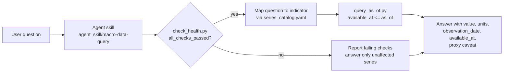

# Agent-ready data product

The same dataset serves three readers: a backtest, an analyst in a spreadsheet, and an
AI agent answering questions. The agent is the one most likely to quietly use the wrong
number, so it gets the strictest interface.

## What "agent-ready" means here

| Property | How it is met |
|---|---|
| **Documented** | Every series has a catalog entry: provider, code, units, frequency, release lag, `exact`/`proxy` coverage, notes. Indicators map to series with a role (primary, secondary, supporting). |
| **Health-checked** | `pipeline/check_health.py` runs eight SQL checks and exits non-zero on any failure. The JSON output names the failing rows, so the agent can say exactly what is wrong. |
| **Point-in-time by default** | The only query tool the agent is given (`pipeline/query_as_of.py`) filters on `available_at`. It cannot accidentally read data from after the date it is asked about. |
| **Read-only** | Health and query scripts open the database with `mode=ro`. |
| **Provenance in every answer** | Rows carry `observation_date`, `available_at`, `coverage_status` and `source_url`; the skill tells the agent to report them. |

## Why a skill over a database instead of live API calls

An earlier version of this tooling was a skill that called FRED, yfinance and
CoinGecko live on every question, with web-scrape fallbacks for the indicators that
have no API. It worked, but each answer depended on several external calls succeeding
at that moment, and it had no notion of "as of": it could only say what the latest
number was today.

Moving the agent onto the ingested dataset changes that:

- **Repeatable.** Two agents asking the same question about the same date get the same
  number.
- **Testable.** The health checks and point-in-time rule are covered by unit tests
  (`tests/test_pipeline.py`).
- **Cheaper and faster.** One local SQLite read instead of a dozen HTTP calls.
- **Historical questions become possible.** "What did the yield curve look like on the
  day of the March 2023 bank failures?" is a single `--as-of` query.

## Installing the skill

The skill is a plain folder with a `SKILL.md`. To use it with Claude Code, copy or
symlink `agent_skill/macro-data-query` into your project's `.claude/skills/` directory
and run Claude Code from the repo root so the relative paths resolve.
