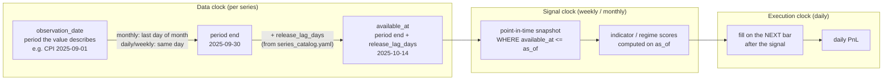

# The three clocks: how this dataset avoids lookahead

A backtest is only as honest as its timestamps. Macro data makes this easy to get
wrong, because the date a source puts on a value is not the date anyone could know it.

## The problem in one example

FRED labels US CPI for September 2025 as `2025-09-01`. The Bureau of Labor Statistics
publishes it in mid-October. A backtest that joins CPI to prices on the label date
"knows" September inflation six weeks early, on the first day of the month it
describes. Nothing errors. The strategy just looks better than it could ever be live.

Daily market prices have a smaller version of the same problem: a close is only known
after the close, so a signal computed from it cannot also trade at it.

## Three clocks, kept separate

| Clock | Question it answers | Where it lives |
|---|---|---|
| **Data clock** | When could this value first be known? | `raw_observations.available_at` |
| **Signal clock** | When do we recompute the regime / indicator scores? | Your scheduler: weekly or monthly, reading with `available_at <= as_of` |
| **Execution clock** | When do trades fill and PnL get booked? | Backtester: the bar after the signal (daily, even with monthly signals) |

Monthly signals with daily PnL is fine. Each clock just has to read only what the
clock before it has released.

## How the rule is implemented

1. **One function owns the data clock.** `compute_available_at(observation_date,
   release_lag_days, frequency)` in [`pipeline/_common.py`](../pipeline/_common.py):
   `available_at = end_of_period(observation_date) + release_lag_days`. Every ingester
   (FRED, yfinance, CoinGecko, staged CSV, synthetic sample) goes through it.
2. **The lag is data, not code.** Each series in
   [`config/series_catalog.yaml`](../config/series_catalog.yaml) declares
   `native_frequency` and `release_lag_days`. Changing an assumption is a one-line edit
   that is reviewed like any other.
3. **The database refuses impossible rows.** `raw_observations` has
   `CHECK (available_at >= observation_date)`.
4. **The health checks verify it after the fact.** In
   [`sql/health_checks.sql`](../sql/health_checks.sql), `no_lookahead` and
   `lag_respected` fail if a row is available before its label date plus the catalog lag
   (for example, CPI loaded with `available_at = observation_date`).
   `lag_from_period_end` measures from the end of the period instead, so it also catches
   the subtler bug: a lag added to the label date (CPI for September available on
   2025-09-15). `lag_respected` alone passes that rule exactly.
5. **Readers only get point-in-time queries.**
   [`sql/point_in_time.sql`](../sql/point_in_time.sql) and
   [`pipeline/query_as_of.py`](../pipeline/query_as_of.py) return, per series, the
   newest value with `available_at <= as_of`.
6. **The backtester fills on the next bar.** `sma_cross` detects a cross on bar *i*
   and fills at the close of bar *i+1*; `median_long_short` ranks on closes up to *t*
   and holds from *t* to *t+hold*.

## Worked example (from the tests)

`tests/test_pipeline.py::test_cpi_as_of_shows_august_not_september`. As of
2025-10-10:

| Label (`observation_date`) | Naive "known from" | `available_at` here | Known on 2025-10-10? |
|---|---|---|---|
| 2025-09-01 (September CPI) | 2025-09-15 | 2025-10-14 | No |
| 2025-08-01 (August CPI) | 2025-08-15 | 2025-09-14 | Yes, the newest known value |

The naive rule (lag counted from the label date) would hand the strategy September CPI
on 2025-09-15, before September had even ended.

## Lag assumptions in the catalog

| Series | Frequency | Lag (days after period end) | Why |
|---|---|---|---|
| `FRED:WALCL`, `FRED:WTREGEN` | weekly | 7 | H.4.1 is out the next day; 7 is deliberately conservative |
| `FRED:RRPONTSYD` | daily | 1 | Published the next business day |
| `FRED:CPIAUCSL` | monthly | 14 | CPI is released around mid-month for the prior month |
| `FRED:M2SL` | monthly | 28 | H.6 comes out about four weeks after month end |
| `FRED:FEDFUNDS`, `FRED:GS10`, `FRED:TB3MS` | monthly | 14 | Monthly averages; conservative |
| `FRED:PCOPPUSDM` | monthly | 30 | IMF commodity prices lag by about a month |
| `MANUAL:ISM_PMI` | monthly | 1 | First business day of the following month |
| `MANUAL:CB_GOLD_NET_TONNES` | monthly | 60 | Reserve data is about two months in arrears |
| Daily market prices (yfinance, most FRED daily) | daily | 0 | Known at the close; the execution clock adds the one-bar delay |

## Known limits

- **Revisions.** FRED serves the latest revised value. Payrolls, GDP and (less so) CPI
  get revised, so a backtest still sees slightly cleaner numbers than were printed on
  the day. The fix is to pull vintages from ALFRED and store one row per
  `(series_id, observation_date, vintage_date)`.
- **Calendar days, not release calendars.** Lags are fixed day counts. A real release
  calendar (BLS, Fed, ISM) would put each value on its exact publication date.
- **Time zones.** Dates are UTC calendar days. Intraday signals would need timestamps.
